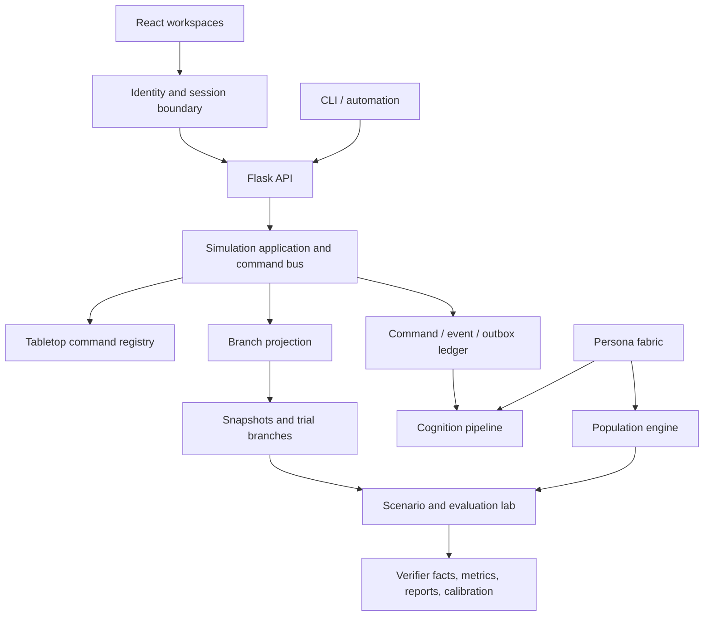

# Architecture and invariants

## System shape

The system separates human identity, simulation authority, canonical state, subjective minds,
large populations, and experimental evidence.



`world_id`, `run_id`, and `interaction_id` are kernel terms. Campaigns, sessions, and encounters
are tabletop interpretations rather than core primitives.

## Identity, roles, actors, and capabilities

Human access has two role scopes:

- `ADMIN` is a global platform role.
- `DM` and `PLAYER` are grants tied to a specific world.

Every account has an actor ID. The identity repository translates role changes into explicit
world/actor authority rows used by the simulation kernel and PostgreSQL RLS. A grant in one
world never authorizes another world.

Actors are `HUMAN`, `AGENT`, or `SYSTEM`. Their world-scoped roles, capabilities, and controlled
entities authorize operations such as:

- `world.read` and `world.read.all`;
- `entity.control` and `entity.read.secret`;
- `entity.act` for acting through explicitly assigned embodied entities;
- `action.propose` and `action.commit`;
- `run.branch`;
- `mind.read.all` and `mind.write.all`;
- `metric.evaluate`;
- `canonical.promote`.

The API checks product roles; the command bus checks simulation capabilities and controlled
entities; PostgreSQL repeats protected-state checks with forced RLS.

## State, commands, and events

Human movement preferences are operational evidence, separate from character memory and canonical
truth. An injected builder captures only perception-scoped pre-command features while the kernel
holds its mutation lock. The durable adapter commits private append-only evidence with its source
command/event/outbox; failure rolls back the entire action. Reference receipts retain the same
internal evidence and publish it after commit. Evidence never enters sensory event payloads.

Input origin is independent of execution authority: the HTTP boundary derives HUMAN_INPUT,
POLICY_ADVICE, or OPERATOR; old/direct commands default to UNSPECIFIED. Only untraced HUMAN_INPUT
movement through the bound human owner's body trains this first policy. Profiles are deterministic,
content-addressed, keyed by player actor/character/exact world-branch-run-body, and frozen inside
private proposal receipts. They do not change the pinned persona or introduce account/control facts
into character fiction. Broader language, risk, relationship and tactical inference remains planned.

Authored character identity is private portal data, distinct from account identity, persona,
embodied entity, and mind. Its typed backstory/values/knowledge claims persist in the existing
character sheet and receive a deterministic current-content identifier. They do not create
canonical facts, observations, memories, or runtime assignments. Private immutable revisions and
explicit live bindings pin the authored identity independently from experience and runtime.

`BranchState` contains named projections, a monotonically increasing version, and a stable
SHA-256 state hash. Supported delta operations are `SET`, `MERGE`, `DELETE`, and `INCREMENT`.

Command definitions declare a stable name/version, typed input, typed output, required
capabilities, eligible branch kinds, and a deterministic handler. The in-memory adapter applies
deltas to a copy and publishes only after success. The PostgreSQL adapter locks the branch
projection and commits the projection, command, event, and outbox in one transaction.

`EventEnvelopeV2` carries world/branch/run/interaction lineage, actor and embodied entity,
visibility and observation scope, correlation/causation, idempotency, seed, decision trace,
persona/policy/prompt/model versions, tags, payload, and creation time.

Command handlers may declare a deterministic sensory emission. A shared event factory resolves
that emission against pre/post-command spatial state and returns the canonical envelope plus
entity-scoped, event-time-frozen perception grants. Raw event authorization (`visible_to`) is not
physical witness membership. See [Spatial epistemics](SPATIAL_EPISTEMICS.md).

## Canonical state, snapshots, trials, and replay

Each world has one canonical branch. A snapshot is a deterministic gzip artifact containing the
projection, command boundary, contract version, and content hashes. Trial branches load an
immutable snapshot and preserve logical entity IDs beneath a different branch-scoped key.

Trials write only their own projection and ledger. Canonical promotion is a separate reviewed
command requiring:

- a real source trial in the same world;
- `canonical.promote` and `action.commit`;
- explicit consequence deltas and a human review note;
- the expected current canonical state hash.

Replay starts at the latest valid branch snapshot and reapplies subsequent durable command
records. Each resulting hash must equal the committed hash.

## Battlefield control and presentation

Tactical, third-person, and first-person play are camera/input modes over the same branch state.
The commander, followers, enemies, weapons, health, upgrades, objectives, and encounter ledger
are never duplicated for a perspective change.

`domains.tabletop.battlefield` provides typed mode and squad-order commands, shared weapon
contracts, an authorized `BattlefieldFrame`, and renderer/input protocols for a future external
engine. Tactical mode maps to formation authority; third- and first-person map to direct commander
authority. Squad AI remains active in every mode.

Presentation is downstream of knowledge. The frame builder requires entity IDs already approved
by perception/visibility policy, so a tactical camera cannot reveal hidden canonical state. A
future browser or 3D engine consumes frames and submits input envelopes; it never receives a
mutable world projection.

See [Battlefield control modes and renderer hooks](BATTLEFIELD_CONTROL_AND_RENDERER_HOOKS.md).

## Persona fabric

The schema registry loads 80 dimensions from four YAML packs:

- `core`: cognition, personality, values, communication, social style, risk, and habits;
- `world`: species, culture, religion, class, education, occupation, and faction context;
- `tabletop`: experience, rules familiarity, play preferences, optimization, and metagaming;
- `accessibility`: reading, visual, motor, cognitive-load, and interface preferences.

Dependencies and constraints form a graph. Generation uses a declared schema version, generator
version, ruleset version, seed, fixed dimensions, and optional weighted distributions.
Provenance records the source of each field. The compiler turns deep traits into policy weights,
starting beliefs/goals/relationships, routines, capability modifiers, retrieval filters, and a
bounded prompt summary.

Blueprints and compiled profiles carry a `CHARACTER` or `SIMULATED_PLAYTESTER` purpose. Purpose
is part of character generation/version identity and cannot be overridden during compilation.
The character compiler allows only core/world dimensions into deep traits and prompt selection;
it does not seed player goals, GM trust, interface capabilities, or evaluation retrieval filters.
Initial character goals and knowledge require authored identity and experience in later campaign
wiring. Playtester behavior remains the default for existing callers. Legacy playtester UUIDs
and hashes omit the default purpose field to preserve immutable historical identities.

## Subjective cognition

The tabletop perceived-scene reader lives in `domains/tabletop/spatial/service.py` and is shared
by scene and character-context reads. `cognition/context.py` assembles an immutable context using
injected source-event and frozen-grant readers. Observation payloads must remain within both the
recorded mask and the original physical grant; beliefs need matching visible claims, and memory
summaries are grounded again in the same observation. Operator-tagged and other-branch evidence
is excluded. The model-facing situation omits account/control and timeline/ledger metadata.
Context reads do not mutate minds or the world. Legal action providers are a server injection
point; the HTTP route injects the [tabletop basic action provider](../domains/tabletop/character_actions.py).
It uses only the authorized perceived scene and world-scoped actor authority, offering typed
movement attempts without probing hidden truth. Kernel validation still decides outcomes. The existing caller-authored
decision API is now restricted to privileged playtester evaluation and refuses character personas
until the live identity/context/candidate path is connected.

Scene and context reads hydrate durable observations into a request-local mind snapshot under
the caller's RLS scope. They never replace the shared projector cache. Accepted embodied command
receipts carry a scoped refresh cursor; the scene API checks the frozen grant's expected
observation before acknowledging readiness. Refresh metadata stays outside character context
and its evidence hash. The console renders only observations and cancels reads on scope changes.

Canonical truth, raw authorization, physical perception, observation, belief evidence, memory,
relationship, and narration are separate records.

`tabletop.character_card_revisions` archives authored content on a saved-card insert or authored
edit. `tabletop.character_bindings` is an append-only controller-configuration ledger that pins a
card revision and exact `CHARACTER` compiled profile to one world/branch/run/body and the existing
mind key. It grants no control and writes no canonical projection. Existing unused legacy persona
entity assignments are not a second binding source. Initial roster assignment creates a missing
binding; adopting another revision requires an explicit successor. Only the pinned self fiction
enters character context, and starting knowledge claims remain distinct from learned evidence.
Live CHARACTER proposal advice uses `domains/tabletop/character_context.py` to resolve that pinned
identity and the shared knowledge boundary. `cognition/character_decisions.py` derives scoped
decision IDs/seeds and runs local utility policy over server-owned movement candidates. Migration
006 stores proposal receipts and existing traces in one transaction, with private forced RLS and
append-only provenance. The durable repository locks the authorized run before the branch and
hydrates a request-local canonical snapshot; reference reads share a command publication lock.
Generation waits for all frozen sensory grants to have corresponding subjective observations.
Advice is PROPOSAL_ONLY, leaves runtime control untouched, and is not an autonomous scheduler.

Explicit handoff is a separate operational path. Migration 007 adds a world/branch/run/body
controller projection and append-only receipts, extending runtime selection with owner/executor
identities, epoch, mode, budget, step, and due time. Body ownership remains unchanged. A dedicated
AGENT receives minimal world capabilities and entity-scoped context grants; it never borrows a
player's session. Ordinary runtime configuration cannot change a managed controller.

The worker reads due rows, resolves pinned context, generates an epoch/step proposal, and submits
through the kernel. Under the mutation lock, controller validation, canonical changes, and step/
budget advancement are atomic. Handoff takes the same branch lock; reference handoff also shares
the direct CommandBus state lock. Missing/stale managed epochs fail closed, including old human
requests. Concurrent workers can commit a logical action only once. Failure pauses and perception
lag defers bounded work. This worker uses local movement utility, not a narrative/world-clock
scheduler. Physical perception grants retain the actual body owner when an executor acts.
Unowned witnesses use authorized world projection infrastructure, leaving the character executor
limited to its own mind. Control records and scheduling metadata never enter sensory fiction.

Durable scene/context requests also hydrate current canonical state into a request-local
snapshot, so actions committed by a separate runner update the existing API's view without
restarting it. This read does not replace the API/projector's shared state caches.

The pure subjective pipeline is:

```text
frozen entity grant -> perceived observation -> belief evidence/revision -> selective memory
             -> goal/need activation -> candidate actions
             -> reflex / utility / bounded plan / typed deliberation
             -> CommandProposal
```

Reflex, utility, and bounded GOAP tiers are deterministic. Model deliberation is optional,
receives an allowed action set, and must return a typed proposal; provider failure falls back to
policy. Runtime assignments cap which tier may act. Relationship changes require a visible
same-branch source event and preserve immutable causal history.

## Population engine

Population operates at three levels:

| Level | Representation | Use |
| --- | --- | --- |
| Statistical | Parquet distributions queried with DuckDB | millions of potential people and cohort analysis |
| Materialized | persistent person and compressed state | households, occupation, finances, beliefs, and scheduled background updates |
| Active | full in-scene cognition state | perception, planning, relationships, and optional model calls |

Pools are immutably bound to a world and branch. Generation streams bounded batches. Filtering,
weighted sampling, stratified sampling, and aggregates execute in DuckDB. Lifecycle transitions
preserve persistent state and monotonic world steps.

## Scenario and evaluation lab

A scenario version specifies a base snapshot, world setup, cohort, intervention, allowed actions,
horizon, stop conditions, runtime/model assignment, seeds, verifiers, and metric contracts.

The lab creates an isolated branch per trial, executes typed proposals, records the trial ledger,
normalizes verifier facts, reduces metrics, and builds a cohort report. Jobs checkpoint per trial,
support cancel/retry, and restore completed inspection history after restart. A process interrupted
while `RUNNING` restores as an explicit retryable failure rather than assuming side effects did or
did not complete.

Calibration compares a synthetic report with versioned evidence. Review approves or rejects the
proposal. Promotion registers an approved immutable version; selecting a runtime version remains
a separate operator decision.

## Storage map

| Store | Data |
| --- | --- |
| PostgreSQL | identity, roles, worlds, branches, projections, actors, entities, sessions, characters, games, minds, lifecycle state, experiment catalogs, telemetry, and ledgers |
| Redis/RQ | experiment queues, job delivery, retry coordination |
| Qdrant | semantic lore and retrieval collections |
| Parquet + DuckDB | large persona pools, cohort queries, population analysis |
| Artifact volume | snapshots, trial outputs, reports, calibration records, replay bundles |
| Static bundle | compiled React application under `static/v2` |

## Package map

```text
TableTop_DM/
├── identity/                 accounts, sessions, roles, audit
├── kernel/                   contracts, command bus, state, branches, API
├── domains/tabletop/         tabletop commands and user portal
├── persona/                  schema, generation, validation, compilation
├── cognition/                subjective state and layered decisions
├── population/               cohorts, Parquet/DuckDB, lifecycle
├── experiments/              scenarios, trials, metrics, reports, calibration
├── frontend/                 React source
├── static/v2/                production frontend bundle
├── infra/                    migrations and Compose
├── scripts/                  lifecycle, tests, readiness, wheel verification
└── tests/                    unit, contract, integration, browser suites
```

The broader workspace concept used to guide the role-specific surfaces is available as the
[multi-surface interface concept](../frontend/design/simulation-kernel-multi-surface-concept.png).

## Non-negotiable invariants

1. Models never own world truth.
2. Human identity, simulation actor, persona, body, mind, and runtime remain distinct.
3. Canonical truth, observation, belief, memory, relationship, and narration remain distinct.
4. Persona profiles and scenario definitions are versioned and reproducible.
5. Every stochastic decision records its seed.
6. Every model decision records model, prompt contract, policy, runtime, and trace provenance.
7. Canonical mutations pass through typed validation and authorization.
8. Experiment branches cannot mutate canonical state.
9. Verifiers emit normalized facts with evidence.
10. Synthetic results are hypotheses, not human ground truth.
11. World-scoped roles and capabilities never leak across worlds.
12. Secrets, credentials, private notes, and secret entity state never enter public projections or
    client-visible logs.
