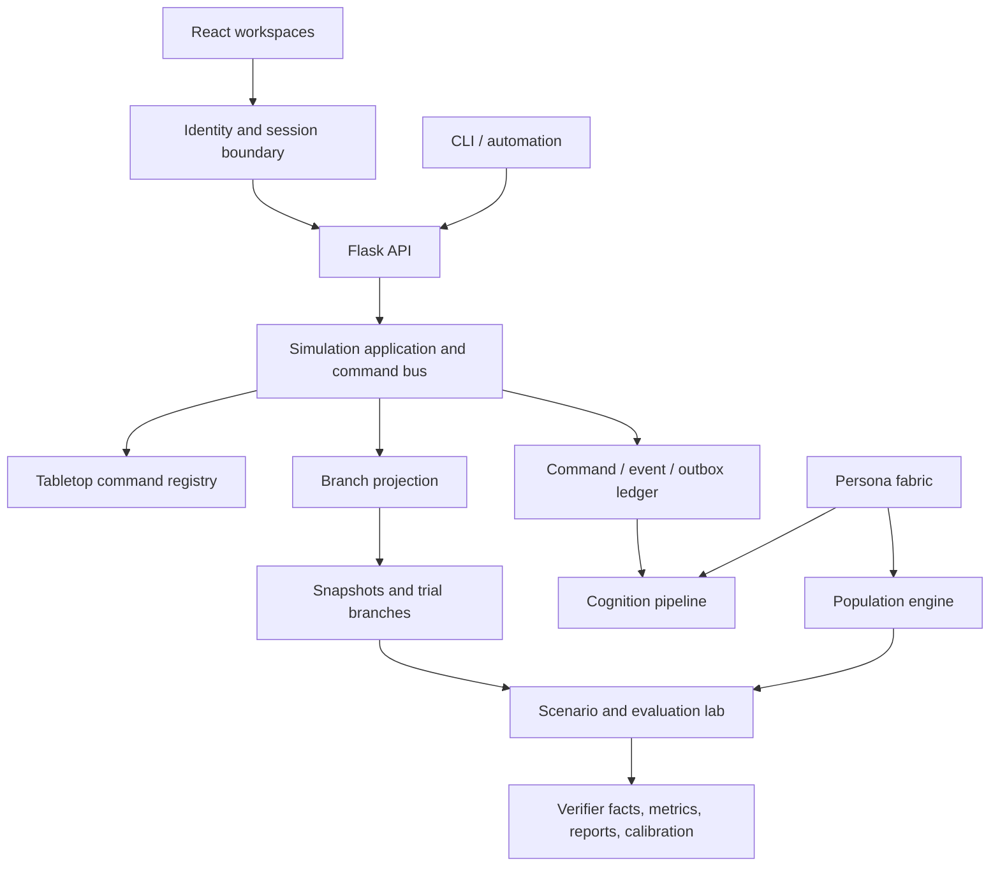

# Architecture and invariants

## System shape

Roster preparation creates an uncontrolled canonical body and pins its card/persona without
publishing a seat. Finalization composes the portal seat with a typed controller mutation in
one actor-scoped PostgreSQL transaction. Reference mode enlists seat publication before atomic
command publication. Neither path grants a model or client direct canonical write access.
Controller identity/history stay immutable; removing a seat pauses the runtime, advances its
epoch and revokes body/runtime-owner access. Shared seats retain their existing grant.

Console synchronization polls only authorized scenes, fences obsolete requests and rejects older
projection versions. Observations may advance at the same version. Map configuration is a
separate typed presentation command/projection; only perceived-zone maps and experience readiness
are added to HTTP interface responses. Character scene contracts and cognition never receive
these interface fields. Durable readiness accepts complete same-event/body/mask/time evidence at
the database's stored confidence precision, retaining original IDs and frozen visibility.

Timed conditions are typed records stored separately from a body's permanent condition list.
Each source retains its creating command/run and absolute simulated expiry. Existing rule
evaluation unions active timed sources with permanent conditions; expiry removes only the due
source. The authorized clock works on a private copy and splits elapsed progression at effect,
readiness and weather boundaries before emitting ordinary canonical deltas. This preserves
split-versus-whole physical outcomes and prevents work or joint attendance during incapacity or
reserved action time. Private source metadata is not added to player scenes or live sheets.

Configured branch clocks govern controlled-action readiness through the domain wrapper
`action-time.1`. Successful effects and the `tabletop.action_time` reservation share one kernel
transaction. The wrapper reads body speed and versioned rules, never client duration values.
No action advances global time; the existing clock runner/authorized advance does so, preserving
offscreen work. Branch locking serializes competing commands for one body; unrelated bodies can
act at the same simulated instant. Failed attempts leave neither effects nor reservations.
Readiness is physical branch state across run reconfiguration, snapshots, trials and restart;
new actions require the clock to belong to their current run. Only the observer's own readiness
is included in its scene. This is a sequential action-time model, not a full initiative system.

An embodied character's physical resources are owned by its canonical body. Portal card updates
cannot change HP/status/max HP/armor/speed or retarget that bound card's world. This applies to
owners and administrators alike; card ownership does not grant an alternate canonical write path.
Identity edits remain authored/versioned separately, and unbound cards still author initial values.

Character live-state reads project the canonical branch's physical body into a typed allowlist;
they do not synchronize wounds/resources back into authored cards. HTTP composition checks card
ownership, current world access and body inspection authority, then freezes the reference read
or uses a fresh durable snapshot. Card identity/version and body projection/version remain distinct.

Registered controlled commands share the `voluntary-body.1` capability/wakeup policy. Human
wakeup is evaluated in an isolated awake copy and committed only with a successful result.
Incapacity rejects before handler execution; private conditions are not inferred for other bodies
through scene status. The own-body scene can suppress impossible stand-in action candidates.

The generic cognition API dispatches explicit CHARACTER requests to the same trusted response
builder and append-only proposal receipts as the entity-scoped character endpoint. It accepts
scope/idempotency only, so identity, scene, learned knowledge and action candidates remain
server-derived. Caller-authored evaluation is an explicit privileged playtester path.

Physical-action RNG is allocated by the commit boundary from recorded run seed and next branch
projection version, after original-receipt lookup and under the same transaction/lock as mutation.
The private result records `logical-action-rng-1.0.0` provenance. Policy-selection seeds and traces
remain separate; event-time physical masks exclude RNG provenance from character observations.

The system separates human identity, simulation authority, canonical state, subjective minds,
large populations, and experimental evidence.

Versioned tabletop action rules resolve melee statistics from the current body and its owned
weapon, and spell effects from registered definitions plus body-owned learned spells/resources.
Human and autonomous proposals use the same typed handlers. Scope-checked committed receipts
are loaded before current request normalization so a contract upgrade preserves old retries;
new keys must satisfy the current strict schema. Replay consumes recorded outcomes.



`world_id`, `run_id`, and `interaction_id` are kernel terms. Campaigns, sessions, and encounters
are tabletop interpretations rather than core primitives.

## Identity, roles, actors, and capabilities

Human access has two role scopes:

- `ADMIN` is a global platform role.
- `DM` and `PLAYER` are grants tied to a specific world.

Every account has an actor ID. The identity repository translates role changes into explicit
world/actor authority rows used by the simulation kernel and PostgreSQL RLS. A grant in one
world never authorizes another world.

Actors are `HUMAN`, `AGENT`, or `SYSTEM`. Their world-scoped roles, capabilities, and controlled
entities authorize operations such as:

- `world.read` and `world.read.all`;
- `entity.control` and `entity.read.secret`;
- `entity.act` for acting through explicitly assigned embodied entities;
- `action.propose` and `action.commit`;
- `run.branch`;
- `mind.read.all` and `mind.write.all`;
- `metric.evaluate`;
- `canonical.promote`.

The API checks product roles; the command bus checks simulation capabilities and controlled
entities; PostgreSQL repeats protected-state checks with forced RLS.

## State, commands, and events

World time and initial offscreen activities use existing canonical branch projections and the
same atomic command/event/outbox transaction. Typed clock configuration pins an explicitly granted
AGENT and an epoch; ticks compare epoch/step while the branch is locked. All workers use one logical
retry key per step and fresh durable snapshots. Clock pause fences unattended character actions at
commit. Operational UTC/downtime policy stays separate from integer simulated seconds.

Scheduled weather splits elapsed activity work at deterministic boundaries. Initial WEED/REST
rows own progress; canonical bodies alone own resulting work/fatigue. Viewer presence has no effect.
Scenes expose inspected current activity only. Configuration/ticks/pending work are operational
records with no sensory emission. Population lifecycle coupling and a generic leased queue remain
separate; see [the workflow](API_AND_WORKFLOWS.md#world-time-and-offscreen-activities).

Generated dialogue is an optional expression layer after deterministic intent selection. An
injected provider receives sanitized identity and sourced subjective experience, never simulation
authority or profile/controller metadata. Its typed text/source response replaces only speech
text; claims stay empty. Private immutable receipts freeze output hashes, supporting events and
model/prompt versions. References bound evidence but cannot certify semantic truth. The kernel
remains the sole canonical mutation path, including fallback speech.

Guard and spell invocation are registered deterministic commands. The server owns guard benefit
and spell effect/cost/range. Candidates use perceived own resources and known visible threats.
Migration 010 extends new human choice evidence without rewriting old profiles or learning from
autonomous output.

Speech/combat choice profiles are separate from the immutable movement-profile schema. They
freeze their own content-addressed version and private human source IDs inside proposal receipts.
New choice evidence and legacy movement evidence commit in one kernel transaction through an
injected bundle sink. Raw historical utterances are not preference payloads or generated replies.
The trusted context orders eligible observations by canonical source-event sequence, so equal
wall-clock timestamps cannot reverse a conversation across restart.

Only a validated perceived attack against this body marks a currently visible body as a threat.
The catalog offers melee, guard, fixed spell attempts, movement and speech intents. A
fresh conversational/attack turn permits one reply; the character's own reply cannot keep itself
talking. Combat emits frozen physical observations; controller and profile metadata never do.

Human movement preferences are operational evidence, separate from character memory and canonical
truth. An injected builder captures only perception-scoped pre-command features while the kernel
holds its mutation lock. The durable adapter commits private append-only evidence with its source
command/event/outbox; failure rolls back the entire action. Reference receipts retain the same
internal evidence and publish it after commit. Evidence never enters sensory event payloads.

Input origin is independent of execution authority: the HTTP boundary derives HUMAN_INPUT,
POLICY_ADVICE, or OPERATOR; old/direct commands default to UNSPECIFIED. Only untraced HUMAN_INPUT
movement through the bound human owner's body trains this first policy. Profiles are deterministic,
content-addressed, keyed by player actor/character/exact world-branch-run-body, and frozen inside
private proposal receipts. They do not change the pinned persona or introduce account/control facts
into character fiction. Broader language, risk, relationship and tactical inference remains planned.

Authored character identity is private portal data, distinct from account identity, persona,
embodied entity, and mind. Its typed backstory/values/knowledge claims persist in the existing
character sheet and receive a deterministic current-content identifier. They do not create
canonical facts, observations, memories, or runtime assignments. Private immutable revisions and
explicit live bindings pin the authored identity independently from experience and runtime.

`BranchState` contains named projections, a monotonically increasing version, and a stable
SHA-256 state hash. Supported delta operations are `SET`, `MERGE`, `DELETE`, and `INCREMENT`.

Command definitions declare a stable name/version, typed input, typed output, required
capabilities, eligible branch kinds, and a deterministic handler. The in-memory adapter applies
deltas to a copy and publishes only after success. The PostgreSQL adapter locks the branch
projection and commits the projection, command, event, and outbox in one transaction.

`EventEnvelopeV2` carries world/branch/run/interaction lineage, actor and embodied entity,
visibility and observation scope, correlation/causation, idempotency, seed, decision trace,
persona/policy/prompt/model versions, tags, payload, and creation time.

Command handlers may declare a deterministic sensory emission. A shared event factory resolves
that emission against pre/post-command spatial state and returns the canonical envelope plus
entity-scoped, event-time-frozen perception grants. Raw event authorization (`visible_to`) is not
physical witness membership. See [Spatial epistemics](SPATIAL_EPISTEMICS.md).

## Canonical state, snapshots, trials, and replay

Each world has one canonical branch. A snapshot is a deterministic gzip artifact containing the
projection, command boundary, contract version, and content hashes. Contract 2.1 also freezes each
entity's identity, controller and secret metadata at that boundary. Public body resources remain
only in the projection. Snapshot identity includes metadata; replay state hashes still identify
projections. Migration 012 permits distinct artifacts with the same projection and command boundary.
Trial branches load an
immutable snapshot and preserve logical entity IDs beneath a different branch-scoped key.

Durable capture locks branch then projection, reads entity metadata and command boundary, and
persists artifact metadata plus manifest in one transaction. Trial creation persists only that
trial's branch, projection, entities and run; it never resynchronizes world grants. Memory publishes
after commit. Nested trials restore the selected snapshot's metadata, never today's canonical
entities. The exact base snapshot ID survives hydration even when projection hashes match.
Legacy 2.0 artifacts remain readable for replay; new trial restoration from them fails closed
because their historical entity metadata is unavailable. Minds, evidence, population source stores,
controller assignments and retrieval indexes still need complete checkpoint support.

Trials write only their own projection and ledger. Canonical promotion is a separate reviewed
command requiring:

- a real source trial in the same world;
- `canonical.promote` and `action.commit`;
- explicit consequence deltas and a human review note;
- the expected current canonical state hash.

Replay starts at the latest valid branch snapshot and reapplies subsequent durable command
records. Each resulting hash must equal the committed hash.

## Battlefield control and presentation

Tactical, third-person, and first-person play are camera/input modes over the same branch state.
The commander, followers, enemies, weapons, health, upgrades, objectives, and encounter ledger
are never duplicated for a perspective change.

`domains.tabletop.battlefield` provides typed mode and squad-order commands, shared weapon
contracts, an authorized `BattlefieldFrame`, and renderer/input protocols for a future external
engine. Tactical mode maps to formation authority; third- and first-person map to direct commander
authority. Squad AI remains active in every mode.

Presentation is downstream of knowledge. The frame builder requires entity IDs already approved
by perception/visibility policy, so a tactical camera cannot reveal hidden canonical state. A
future browser or 3D engine consumes frames and submits input envelopes; it never receives a
mutable world projection.

See [Battlefield control modes and renderer hooks](BATTLEFIELD_CONTROL_AND_RENDERER_HOOKS.md).

## Persona fabric

The schema registry loads 80 dimensions from four YAML packs:

- `core`: cognition, personality, values, communication, social style, risk, and habits;
- `world`: species, culture, religion, class, education, occupation, and faction context;
- `tabletop`: experience, rules familiarity, play preferences, optimization, and metagaming;
- `accessibility`: reading, visual, motor, cognitive-load, and interface preferences.

Dependencies and constraints form a graph. Generation uses a declared schema version, generator
version, ruleset version, seed, fixed dimensions, and optional weighted distributions.
Provenance records the source of each field. The compiler turns deep traits into policy weights,
starting beliefs/goals/relationships, routines, capability modifiers, retrieval filters, and a
bounded prompt summary.

Blueprints and compiled profiles carry a `CHARACTER` or `SIMULATED_PLAYTESTER` purpose. Purpose
is part of character generation/version identity and cannot be overridden during compilation.
The character compiler allows only core/world dimensions into deep traits and prompt selection;
it does not seed player goals, GM trust, interface capabilities, or evaluation retrieval filters.
Initial character goals and knowledge require authored identity and experience in later campaign
wiring. Playtester behavior remains the default for existing callers. Legacy playtester UUIDs
and hashes omit the default purpose field to preserve immutable historical identities.

## Subjective cognition

The tabletop perceived-scene reader lives in `domains/tabletop/spatial/service.py` and is shared
by scene and character-context reads. `cognition/context.py` assembles an immutable context using
injected source-event and frozen-grant readers. Observation payloads must remain within both the
recorded mask and the original physical grant; beliefs need matching visible claims, and memory
summaries are grounded again in the same observation. Operator-tagged and other-branch evidence
is excluded. The model-facing situation omits account/control and timeline/ledger metadata.
Context reads do not mutate minds or the world. Legal action providers are a server injection
point; the HTTP route injects the [tabletop basic action provider](../domains/tabletop/character_actions.py).
It uses only the authorized perceived scene and world-scoped actor authority, offering movement,
speech and fixed tactical attempts without probing hidden truth. Kernel validation decides outcomes.
Caller-authored evaluation is restricted to privileged playtesters; live characters use their
pinned trusted context through the proposal service and bounded runner.

Character knowledge is a derived, read-only view in `cognition/knowledge.py`. It indexes validated
same-branch observation text before recent-window trimming, plus pinned starting claims. It never
queries the global lore catalog to fill gaps. Durable requests rebuild it from actor-scoped stores;
there is no second mutable knowledge database. Retrieval and generated dialogue share that view,
preserving source-event/card provenance privately and exposing only fiction in model inputs.
Broad scene authority is separate from private mind authority in both repository modes.

One projection readiness guard now fences context, retrieval and proposal generation. Central
non-sensory tags live in kernel perception contracts; event finalization never invokes a physical
builder or resolver for operator/director records. Character context remains scoped even when its
operator can inspect raw events or controls a deity body. Existing branch lineage excludes trial
testimony from the same logical body's canonical mind; full campaign revision remains separate work.

Scene and context reads hydrate durable observations into a request-local mind snapshot under
the caller's RLS scope. They never replace the shared projector cache. Accepted embodied command
receipts carry a scoped refresh cursor; the scene API checks the frozen grant's expected
observation before acknowledging readiness. Refresh metadata stays outside character context
and its evidence hash. The console renders only observations and cancels reads on scope changes.

Canonical truth, raw authorization, physical perception, observation, belief evidence, memory,
relationship, and narration are separate records.

`tabletop.character_card_revisions` archives authored content on a saved-card insert or authored
edit. `tabletop.character_bindings` is an append-only controller-configuration ledger that pins a
card revision and exact `CHARACTER` compiled profile to one world/branch/run/body and the existing
mind key. It grants no control and writes no canonical projection. Existing unused legacy persona
entity assignments are not a second binding source. Initial roster assignment creates a missing
binding; adopting another revision requires an explicit successor. Only the pinned self fiction
enters character context, and starting knowledge claims remain distinct from learned evidence.
Live CHARACTER proposal advice uses `domains/tabletop/character_context.py` to resolve that pinned
identity and the shared knowledge boundary. `cognition/character_decisions.py` derives scoped
decision IDs/seeds and runs local utility policy over server-owned movement candidates. Migration
006 stores proposal receipts and existing traces in one transaction, with private forced RLS and
append-only provenance. The durable repository locks the authorized run before the branch and
hydrates a request-local canonical snapshot; reference reads share a command publication lock.
Generation waits for all frozen sensory grants to have corresponding subjective observations.
Advice is PROPOSAL_ONLY, leaves runtime control untouched, and is not an autonomous scheduler.

Explicit handoff is a separate operational path. Migration 007 adds a world/branch/run/body
controller projection and append-only receipts, extending runtime selection with owner/executor
identities, epoch, mode, budget, step, and due time. Body ownership remains unchanged. A dedicated
AGENT receives minimal world capabilities and entity-scoped context grants; it never borrows a
player's session. Ordinary runtime configuration cannot change a managed controller.

The worker reads due rows, resolves pinned context, generates an epoch/step proposal, and submits
through the kernel. Under the mutation lock, controller validation, canonical changes, and step/
budget advancement are atomic. Handoff takes the same branch lock; reference handoff also shares
the direct CommandBus state lock. Missing/stale managed epochs fail closed, including old human
requests. Concurrent workers can commit a logical action only once. Failure pauses and perception
lag defers bounded work. This worker uses local movement utility, not a narrative/world-clock
scheduler. Physical perception grants retain the actual body owner when an executor acts.
Unowned witnesses use authorized world projection infrastructure, leaving the character executor
limited to its own mind. Control records and scheduling metadata never enter sensory fiction.

Durable scene/context requests also hydrate current canonical state into a request-local
snapshot, so actions committed by a separate runner update the existing API's view without
restarting it. This read does not replace the API/projector's shared state caches.

The pure subjective pipeline is:

```text
frozen entity grant -> perceived observation -> belief evidence/revision -> selective memory
             -> goal/need activation -> candidate actions
             -> reflex / utility / bounded plan / typed deliberation
             -> CommandProposal
```

Reflex, utility, and bounded GOAP tiers are deterministic. Model deliberation is optional,
receives an allowed action set, and must return a typed proposal; provider failure falls back to
policy. Runtime assignments cap which tier may act. Relationship changes require a visible
same-branch source event and preserve immutable causal history.

## Population engine

Population operates at three levels:

| Level | Representation | Use |
| --- | --- | --- |
| Statistical | Parquet distributions queried with DuckDB | millions of potential people and cohort analysis |
| Materialized | persistent person and compressed state | households, occupation, finances, beliefs, and scheduled background updates |
| Active | full in-scene cognition state | perception, planning, relationships, and optional model calls |

Pools are immutably bound to a world and branch. Generation streams bounded batches. Filtering,
weighted sampling, stratified sampling, and aggregates execute in DuckDB. Lifecycle transitions
preserve persistent state and monotonic world steps.

## Scenario and evaluation lab

A scenario version specifies a base snapshot, world setup, cohort, intervention, allowed actions,
horizon, stop conditions, runtime/model assignment, seeds, verifiers, and metric contracts.

The lab creates an isolated branch per trial, executes typed proposals, records the trial ledger,
normalizes verifier facts, reduces metrics, and builds a cohort report. Jobs checkpoint per trial,
support cancel/retry, and restore completed inspection history after restart. A process interrupted
while `RUNNING` restores as an explicit retryable failure rather than assuming side effects did or
did not complete.

Calibration compares a synthetic report with versioned evidence. Review approves or rejects the
proposal. Promotion registers an approved immutable version; selecting a runtime version remains
a separate operator decision.

## Storage map

| Store | Data |
| --- | --- |
| PostgreSQL | identity, roles, worlds, branches, projections, actors, entities, sessions, characters, games, minds, lifecycle state, experiment catalogs, telemetry, and ledgers |
| Redis/RQ | experiment queues, job delivery, retry coordination |
| Qdrant | semantic lore and retrieval collections |
| Parquet + DuckDB | large persona pools, cohort queries, population analysis |
| Artifact volume | snapshots, trial outputs, reports, calibration records, replay bundles |
| Static bundle | compiled React application under `static/v2` |

## Package map

```text
TableTop_DM/
├── identity/                 accounts, sessions, roles, audit
├── kernel/                   contracts, command bus, state, branches, API
├── domains/tabletop/         tabletop commands and user portal
├── persona/                  schema, generation, validation, compilation
├── cognition/                subjective state and layered decisions
├── population/               cohorts, Parquet/DuckDB, lifecycle
├── experiments/              scenarios, trials, metrics, reports, calibration
├── frontend/                 React source
├── static/v2/                production frontend bundle
├── infra/                    migrations and Compose
├── scripts/                  lifecycle, tests, readiness, wheel verification
└── tests/                    unit, contract, integration, browser suites
```

The broader workspace concept used to guide the role-specific surfaces is available as the
[multi-surface interface concept](../frontend/design/simulation-kernel-multi-surface-concept.png).

## Non-negotiable invariants

1. Models never own world truth.
2. Human identity, simulation actor, persona, body, mind, and runtime remain distinct.
3. Canonical truth, observation, belief, memory, relationship, and narration remain distinct.
4. Persona profiles and scenario definitions are versioned and reproducible.
5. Every stochastic decision records its seed.
6. Every model decision records model, prompt contract, policy, runtime, and trace provenance.
7. Canonical mutations pass through typed validation and authorization.
8. Experiment branches cannot mutate canonical state.
9. Verifiers emit normalized facts with evidence.
10. Synthetic results are hypotheses, not human ground truth.
11. World-scoped roles and capabilities never leak across worlds.
12. Secrets, credentials, private notes, and secret entity state never enter public projections or
    client-visible logs.

### Embodied population and routines

Optional `life.planning` introduces a finite daily intention menu. `population/planning.py`
selects feasible goals from own bodily needs, configured destinations/priorities and current local
physical conditions; it never reads another body's hidden cognition. Goals commit through the
same world-clock handler, using the existing local movement helper and Activity execution.
Private bounded day/goal counters measure fulfillment, not resources. Actual inventory, health,
fatigue, work and position remain solely on the body. Fixed retry/day/need boundaries preserve
coarse-versus-split behavior; viewer presence and population relevance do not select a different
policy. Goal IDs/choices stay outside sensory projections.

With `life.planning.motivated`, the trusted API composition injects an authorized input reader
(`kernel/api/npc_goals.py`). It builds the NPC's own perception-scoped character context from
event-time grants, requires projected experience to be current, and resolves the exact pinned
CHARACTER profile. Approved deep traits are reconstructed from its immutable blueprint because
durable compiled profile rows omit those fields. No private authored card read is needed by the
clock executor. `cognition/goal_motivation.py` validates each belief against a matching perceived
source claim, caps confidence, and derives bounded motive weights and believed-danger avoidance.
`population/motivation.py` freezes these private inputs under the normal clock lock; the handler
alone commits choices and effects. Missing authority, binding or evidence projection fails closed.
Replay uses committed deltas rather than rereading current minds. This links subjective cognition
to the finite physical goal menu; detailed actions and unrestricted goal invention remain E3/F work.

The DM character-card association API links an existing canonical body to a saved card without
creating a player account or party seat. Reference locking and durable body-scoped advisory locks
serialize competing associations; durable updates touch association columns only. Persona pins,
mind state, controller assignments, population identity and body resources remain separate.

`population/runtime.py` connects the existing `PopulationLifecycle` to typed canonical commands.
Each embodied member refers to exactly one existing body. Private branch-local member/history
projections hold identity, lifecycle and selected mental metadata; the body's canonical projection
alone owns health, inventory, hunger, fatigue and work output. Binding preserves the independently
pinned character card/persona/mind. Archived source finances are never imported.

Migration 011 adds source binding evidence, scoped foreign keys and freeze guards. The command
transaction locks and hashes the materialized source, commits the binding with projection/event/
outbox, then prevents legacy state or transition writers from changing that source. Reference
execution validates the same source under its command lock. Live API reads overlay the canonical
member rather than treating the frozen source's activation state as current.

`population/routines.py` advances persisted WEED/REST/EAT phases at completion, need and weather
boundaries inside the existing clock transaction. Deterministic phase IDs and a recorded policy
version support replay. Physical proximity determines automatic lifecycle relevance; connection
or camera presence is never an input. Trial copies resolve identity scope from their own branch
and cannot bind another source. Whole-population planning and richer occupations remain separate.

`population/life.py` adds an opt-in physical schedule to those same routines, under policy
`npc-routines-1.1.0`. A bounded event loop advances all participants to shared movement, need,
sleep, weather and appointment boundaries before choosing their next phases. Travel applies the
same pure cardinal movement/collision helper as manual moves and changes the one canonical position.
It never relocates a body merely to satisfy a meeting. Daily sleep uses simulated time; injury or
accepted human input can wake a sleeper. Captured autonomous actions recheck sleep under the command
transaction, and the character runner preserves its controller budget while the body sleeps.

Social obligations are private branch-local records, not cognition. Attendance requires capable,
awake, physically present participants, and only joint elapsed attendance earns progress. Missing
participants, interrupted attendance and deadlines can cause a missed occurrence. Recurrence stores
counters and the latest outcome rather than creating unlimited jobs. Actual dialogue, beliefs and
relationships still require their existing perception-scoped source events. Scenes expose physical
travel/sleep/social activity but omit plans, destination, route and schedule progress.
